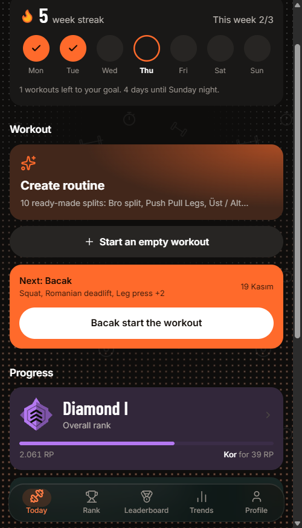
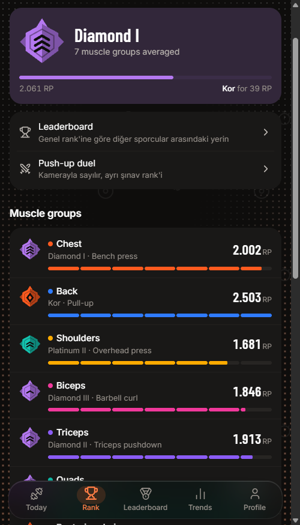
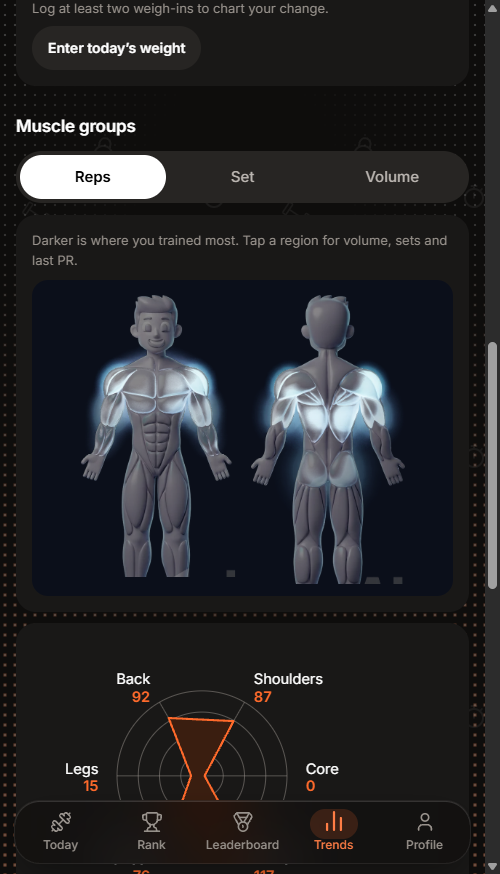
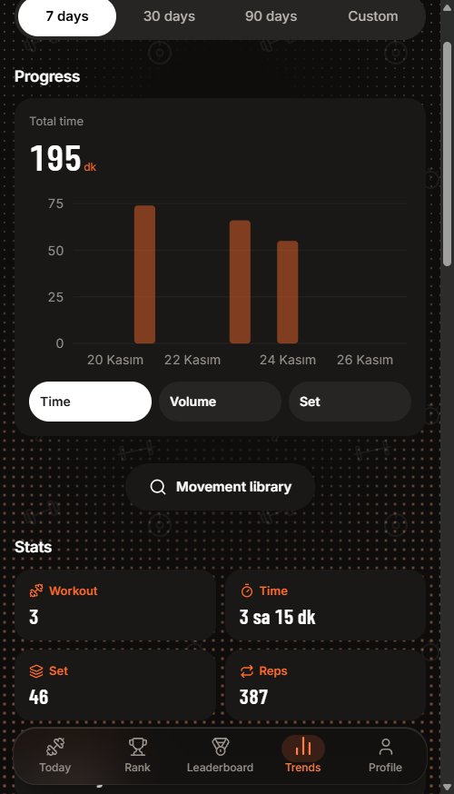

# Kor

Strength-training tracker with a rank for each muscle group. A web app (PWA) you can install on your phone and use offline. Your data stays on the device; optionally it is backed up to the cloud with an account.

## Screenshots

<p align="center">
  
  
  
  
</p>

<p align="center"><sub>Today · Rank · Body map · Trends — shown with the built-in demo data (<code>?demo=1</code>).</sub></p>

## Running

```
npm install
npm run dev        # development, http://localhost:5173
npm run build      # build, output in the dist/ folder
npm run preview    # built version, http://localhost:4173
npx vitest run     # tests
```

If opened with `?demo=1` (for example `http://localhost:4173/?demo=1`) and nothing has been set up yet, it starts with 14 weeks of sample data. Sample data is removed from the Profile screen.

## Installing on a phone

There are three ways to use Kor on a phone: install it as a web app (PWA), sideload the iOS app (`.ipa`), or sideload the Android app (`.apk`). **iOS is the primary, best-tested target; the Android build is experimental (see the note below).**

### 1. Web app (PWA) — any phone

The `dist/` folder is made of static files; it can be uploaded anywhere that serves over HTTPS (Netlify, Vercel, GitHub Pages, Cloudflare Pages). On the phone, open the address and choose "Add to Home Screen" from the browser menu. The service worker only runs over HTTPS or `localhost`; at a home-network `http://192.168...` address the app opens but does not work offline and cannot be installed.

### 2. iPhone / iPad — sideload the IPA with Sideloadly

The IPA is built automatically in the cloud, so you do **not** need a Mac to produce it.

1. Open the repo's **Actions** tab → the **iOS IPA** workflow → the latest green run → **Artifacts** → download **`Kor-ipa`** (contains `Kor.ipa`).
2. Install [**Sideloadly**](https://sideloadly.io) on your **Windows PC or Mac** (iTunes + iCloud from apple.com are also needed on Windows). Connect the iPhone by cable and trust the computer.
3. Drag `Kor.ipa` into Sideloadly, enter your **free Apple ID**, and press **Start**. (An app-specific password may be requested; create one at appleid.apple.com.)
4. On the iPhone: **Settings → General → VPN & Device Management → [your Apple ID] → Trust**. Open Kor.
5. A free Apple ID signature lasts **7 days** — re-run Sideloadly with the same IPA to renew. (A paid Apple Developer account lasts a year.)

**Mac alternative (no Sideloadly):** open `ios/App/App.xcodeproj` in Xcode, select your iPhone, set your free Apple ID team under *Signing & Capabilities*, and press Run — Xcode installs it directly. Or drag `Kor.ipa` onto your device in **Apple Configurator**.

### 3. Android — install the APK

> **Note:** The Android build is **experimental and not yet tested**. It is provided so Android users can try Kor, but it may have rough edges; the app runs best on **iOS**. Please report anything that misbehaves.

1. Open the repo's **Actions** tab → the **Android APK** workflow → the latest green run → **Artifacts** → download **`Kor-apk`** (contains `Kor.apk`).
2. Copy `Kor.apk` to your Android phone (cable, Google Drive, or a direct download).
3. Tap the file. Android will ask to allow **"Install unknown apps"** for the app you opened it from (Files/Chrome) — enable it, then confirm the install.
4. Open Kor. It is a debug build signed with a debug key, so Play Protect may show an extra "install anyway" prompt — that is expected for sideloaded apps.

## How rank is calculated

1. From each working set, an estimated one-rep max (1RM) is derived: `weight × (1 + reps / 30)`. Sets above 12 reps and warm-up sets do not count.
2. The 1RM is divided by body weight. For moves like pull-ups and dips, the load is body weight plus added weight.
3. The ratio falls between 0 and 2100 RP against the move's own standard. The scale is not linear (`RANK_CURVE = 0.7`, `src/lib/rank.ts`): lower and middle tiers open earlier, while the Kor threshold stays fixed. Standards are in `src/lib/exercises.ts` (`start` is the bottom of the ladder, `elite` is the Kor threshold). For women, upper body is multiplied by 0.60 and lower body by 0.75.
4. There are eight tiers: Coal, Iron, Bronze, Silver, Gold, Platinum, Diamond, Kor. The first seven have three steps each, and each step is 100 RP. 2100 RP and above is Kor.
5. A muscle group's rank is set by that group's highest-RP move. The overall rank is the average of ranked groups and requires at least four groups.

The standards are this app's own table; they are not a comparison with other users or a percentile. Moves without a standard (most machines and user-added moves) are recorded but do not count toward rank.

## Structure

- `src/lib/` — logic: `rank.ts` (rank calculation), `stats.ts` (volume, records, streak), `store.ts` (state and `localStorage`), `exercises.ts` (move library), `demo.ts` (sample data), `cloud.ts` and `cloud-core.ts` (account, backup, Premium entitlement), `pricing.ts` (regional pricing).
- `supabase/schema.sql` — database tables and security rules.
- `src/screens/` — screens: Today, workout logging, Rank, muscle group, move, History, workout summary, Profile, routine editing.
- `src/ui/` — logo, charts, shared components.
- `public/sw.js` — offline cache.

Data is kept in `localStorage` under the `kor:v1` key. A JSON backup is exported and restored from the Profile screen.

Premium: the entitlement is read from the `subscriptions` table. A 7-day trial starts without a card via `start_trial()`. **Premium is currently free for everyone during launch — every feature is unlocked.** This is controlled by the `PREMIUM_FOR_EVERYONE` flag in `src/lib/cloud-core.ts`; set it to `false` to return to normal subscription behavior. Payment is not connected yet: while `VITE_CHECKOUT_URL` is empty, the purchase button says so. When a payment provider is connected, its webhook must update the `subscriptions` row with the `service_role` key (on the server).

Locks are in the interface: because analysis is computed from on-device data, a determined user can get past a lock. What is enforced on the server is the entitlement itself.

Pricing lives in `src/lib/pricing.ts` and is for display only; the same table must also be defined in the payment provider. While Premium is free for everyone, these prices are not shown in the app.

## Exercise frames

The move frames under `public/moves/` were taken from the public-domain (Unlicense)
[free-exercise-db](https://github.com/yuhonas/free-exercise-db) dataset and downscaled.
Each move has a start and end frame; they play as a loop on the move page.
